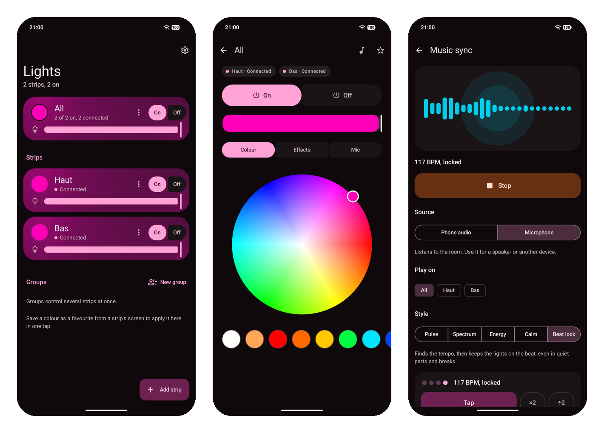
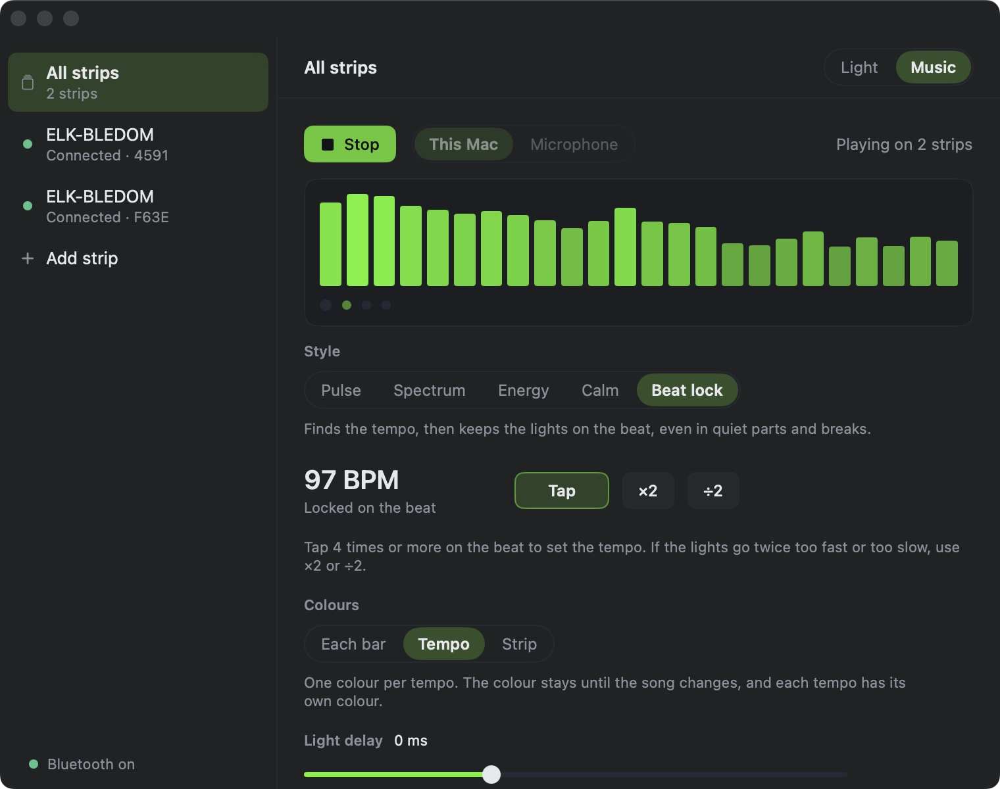

# fff3

fff3 controls Bluetooth LED strips with ELK-BLEDOM and MELK controllers, from an Android phone or a Mac. It changes colour live while you drag, and makes the strips follow the music, on the beat. It has no ads, no tracking and no internet access.

It is for personal use and is not on Google Play or the Mac App Store.

| Android | Mac |
|---|---|
|  |  |
| [Android app](android/README.md) | [Mac app](macos/README.md) |

The name comes from the Bluetooth characteristic that every command is written to: `0000fff3-…`.

## Why it exists

The usual store app for these strips is large, slow and full of ads. It sends a command only after you tap "Set", and it connects again for every command. fff3 keeps the strip connected and changes the colour while you drag.

| | Usual store app | fff3 |
|---|---|---|
| Size | 9.4 MB | about 3 MB on Android |
| Ads and analytics | yes | none, no internet access |
| Commands | 1 every 2 seconds, after a "Set" tap | up to 28 a second, live |
| Connection | scan and connect for each command | added once, kept open |

## What both apps do

Both apps can:

- find strips with their own scan, and reconnect to them on every launch
- set power, colour, brightness, white presets and the built-in effects with their speed
- make the strips follow music, from the device's own sound or the microphone
- light in 5 styles: Pulse, Spectrum, Energy, Calm and Beat lock

Beat lock finds the tempo and keeps the lights on the beat, even in quiet parts and breaks. Both apps run the same Beat lock code and give the same results on every test song. Brightness follows the part of the song: a calm verse is dimmer and a chorus is brighter, whatever the volume.

## What differs

| | Android | Mac |
|---|---|---|
| Groups and favourites | yes | one strip or all strips |
| Timers, wire order, the strip's microphone modes | yes | not yet |
| Tile, widget and shortcuts | yes | no |
| Light delay | measured per strip with the camera | measured once, the same for every strip |
| Install | APK from the releases page | zip from the releases page, Apple silicon |

Each strip accepts only 1 Bluetooth connection at a time. While one app holds a strip, the other cannot reach it.

## For developers

Read [CLAUDE.md](CLAUDE.md) and [ARCHITECTURE.md](ARCHITECTURE.md) before you change code. They cover decisions already made, the build, releases, signing and the tools to test Beat lock on real songs. For the Mac app, read [macos/README.md](macos/README.md) too.

The byte protocol was worked out from the existing app and from live tests on the strips. The full notes are kept outside this repo.

## Licence

fff3 is under the [MIT licence](LICENSE).
