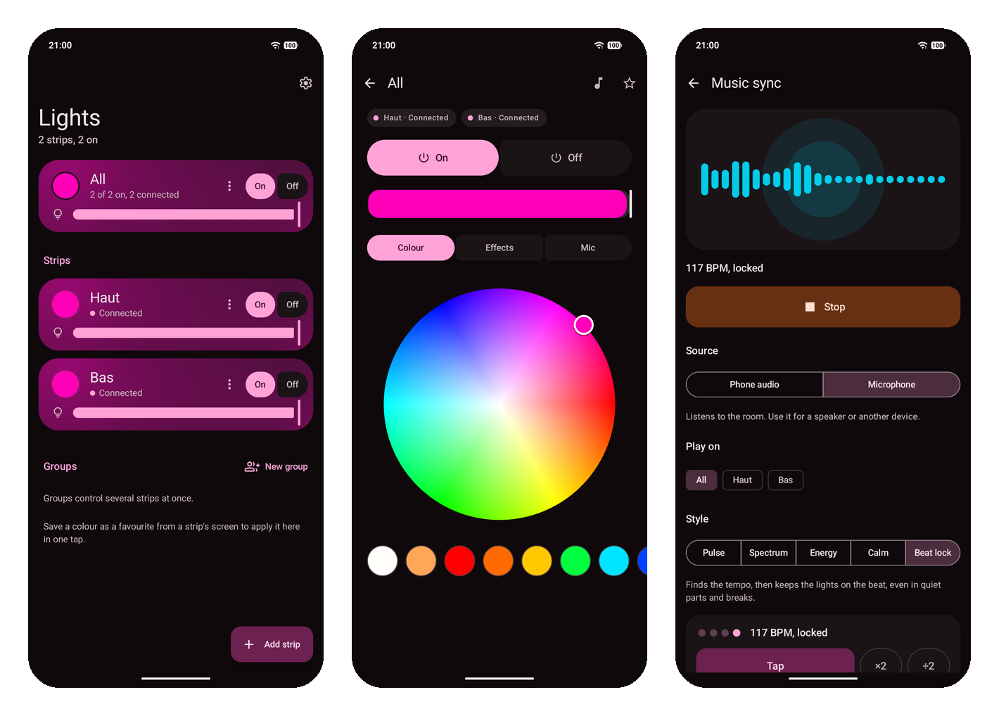

# fff3 for Android

The Android app of [fff3](../README.md): control your ELK-BLEDOM and MELK strips over Bluetooth, and make them follow the music. You need Android 13 or later.



## Install

Download `fff3-<version>.apk` from the [releases page](https://github.com/kernoeb/fff3/releases) and open it on your phone. A new version installs over the old one and keeps your strips and settings.

To build it yourself, you need JDK 17 to 25 and the Android SDK. Then run, from this folder:

```sh
./gradlew :app:assembleRelease
```

Your build is signed with your own debug key, so it does not install over a release APK.

## Control your strips

You can:

- add a strip once from the app's own scan, then reconnect on every launch
- change colour live while you drag the colour wheel
- control several strips at once with groups
- set power, brightness, white presets and built-in effects with their speed
- use the strip's own microphone modes
- save favourites and apply them in one tap
- set per-strip options: name, wire order with a live test, on and off timers, and automatic clock sync
- use the Quick Settings tile, the home-screen widget and app shortcuts

fff3 saves the last state it sent to each strip. When you open the app again, it shows that state.

## Music sync

Your strips can follow music from 2 sources:

- phone audio: what your phone plays, from apps that allow audio capture
- microphone: the sound in the room, for a speaker or another device

There are 5 light styles: Pulse, Spectrum, Energy, Calm and Beat lock.

Beat lock finds the tempo and keeps the lights on the beat, even in quiet parts and breaks. You can:

- choose the colours: a new colour each bar, one colour per tempo, or the strip's own colour
- tap the beat to set the tempo, and use ×2 or ÷2 if the lights go twice too fast or too slow

Brightness follows the part of the song. A calm verse is dimmer and a chorus is brighter, whatever the volume.

## Keep lights in time with the sound

fff3 corrects the delay between the sound and the light. It does this in 3 ways:

- it measures the phone's audio output delay with the microphone
- it measures each strip's light delay with the camera: the strip flashes and the camera sees when it changes
- you can fine-tune the delay by hand if the lights still come early or late

You can start the camera measurement from the strip settings or the music screen.

## Limits

The strips are write-only. They cannot tell the app their power or colour. fff3 only knows what it sent, so the state shows as unknown after you use the remote or another app. For this reason, power has separate On and Off buttons, so each tap does what it says.

Microphone mode is less accurate than phone audio. Room noise and distance from the speaker make the beat harder to find.

Each strip accepts only 1 Bluetooth connection at a time. Close other apps that control the strip before you use fff3, and quit the Mac app if it runs.

## Permissions

The app asks for Bluetooth, microphone, camera and notifications only. It has no internet permission.
