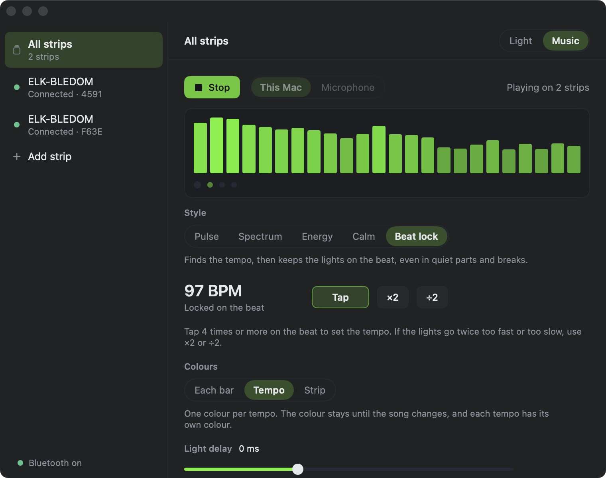

# fff3 for macOS

The Mac app of [fff3](../README.md): control your ELK-BLEDOM and MELK strips over Bluetooth, and make them follow the music this Mac plays or the room hears. You need macOS 14 or later, and 14.2 or later to sync with the Mac's own sound.



## Install

Download `fff3-<version>-macos.zip` from the [releases page](https://github.com/kernoeb/fff3/releases), unzip it and move `Fff3.app` to Applications. It runs on Apple silicon Macs.

The app is not notarised by Apple, so macOS blocks it the first time. To open it:

1. Open it once and close the warning.
2. Go to System Settings, then Privacy and Security.
3. Next to the message about fff3, select Open Anyway.

To build it yourself, use the Xcode command line tools, from the repo root:

```sh
cd macos
./build.sh                      # -> Fff3.app, signed ad hoc
rm -rf /Applications/Fff3.app && cp -R Fff3.app /Applications/
```

Always remove the old app before you copy a new one over it: a copy over the old bundle keeps a stale signature, and macOS refuses to start it. The app is signed ad hoc, so macOS may ask again for Bluetooth, system audio or microphone access after each new build.

Each strip accepts one Bluetooth connection at a time. While the Mac app runs it holds every strip it knows, so the phone cannot reach them. Quit the Mac app to give them back.

## What it does

The Light page has:

- On and Off buttons, as on Android: the strips cannot report their state
- a colour wheel that sends while you drag
- brightness, and 3 whites (2700 K, 4000 K and 6500 K) made from the RGB LEDs
- the family's built-in effects and scenes, with their speed

The Music page has:

- 2 sources: this Mac's sound, through a Core Audio process tap (macOS 14.2 or later), and the microphone
- the 5 styles: Pulse, Spectrum, Energy, Calm and Beat lock
- for Beat lock: tap tempo, ×2 and ÷2, the colour choice (each bar, tempo or strip) and the light delay fine-tune, from -100 to +200 ms

macOS hides Bluetooth addresses, so a strip added on the phone must be added again on the Mac. Strips are saved in `~/Library/Application Support/fff3/data.json`.

Beat lock corrects the delay between the sound and the light by itself: it reads the output and capture delays from macOS, and uses a strip delay measured once with a camera (38 ms). The light delay slider, 0 by default, is for fine-tuning by eye.

## Not on the Mac

These are Android only, or need the phone's hardware:

- widgets, the Quick Settings tile and app shortcuts
- camera light delay calibration per strip: the Mac uses one strip delay measured once
- measuring the speaker delay with the microphone: the Mac reads it from macOS instead
- companion device pairing and haptics

These exist on Android and are not on the Mac yet:

- groups (the Mac has one strip or all strips) and favourites
- per-strip settings: on and off timers, wire order and its test, pixel count
- the controller's own microphone modes

## For developers

Run the protocol checks with `./tools/test.sh`: every frame, with its exact hex.

### How the code is split

- `Sources/Fff3Core/Protocol`: commands, families, frames and catalogues, ported from `protocol/`.
- `Sources/Fff3Core/Music`: `Fft`, `MusicAnalyzer`, `BeatDetector`, `BeatTracker`, `SongEnergy`, `LightRenderer`, `LightTiming` and `PcmConverter`, ported line for line from `music/`. `JMath` gives Kotlin's maths: Float functions computed in Double and rounded once, and rounding that goes half up.
- `Sources/Fff3`: the app. `WriteQueue` keeps the Android write pacing: one frame every 35 ms per strip, drag values coalesced, newest wins. `Bluetooth` holds one link per strip on one serial queue, reconnects with the same backoff, and sends the Mac's time on each connect. `MusicEngine` is `MusicEngine.kt` on a thread.
- `Sources/Fff3Bench`: the Swift twin of `BeatBenchTest.kt`.

### Check that Beat lock matches Android

The bench takes the same input and prints the same lines as `BeatBenchTest.kt`:

```sh
swift build -c release --product Fff3Bench
FFF3_BENCH="song.f32=114;other.f32=92@40" FFF3_BENCH_LOCKS=1 .build/release/Fff3Bench
```

Songs are 48 kHz mono f32le: `ffmpeg -i song.mp3 -ac 1 -ar 48000 -f f32le song.f32`. Run the Kotlin bench with the same `FFF3_BENCH` and compare the lines. `FFF3_BEATS_DIR=dir` writes every beat time, for a closer check.

On 80 runs (11 songs, clean, microphone and quiet versions, from the start and from 40 s), the Swift and Kotlin benches print the same `BENCH` and `LOCK` lines, and the same 24,813 beat times but one, which differs in the last printed digit. Run this check again after any change to `music/`.

### Test switches

These environment variables help to check the app without clicking through it:

- `FFF3_PAGE=light`, `music` or `add` opens that page
- `FFF3_AUDIO_FILE=song.f32` plays a decoded song into the analyser in real time instead of capturing, so music sync can run on the strips without audio permissions
- `FFF3_BLE_LOG=1` prints each frame as it goes to a strip, with the time in milliseconds
- `FFF3_BEAT_LOG=1` prints one Beat lock line a second, like `adb logcat -s fff3-beat`, plus the loudness
- `FFF3_TIMING_LOG=1` prints, on one millisecond clock, when each click was captured, analysed and turned into a beat, to measure the delay inside the app
- `FFF3_STYLE=BeatLock` (or `Pulse`, `Spectrum`, `Energy`, `Calm`) sets the style for this run without saving it
- `FFF3_AUTOSTART=1` starts music sync once every strip is connected

Start the app with `open -n --env FFF3_BEAT_LOG=1 --stderr log.txt Fff3.app`, so it keeps its own audio permission: a binary started from a shell captures silence. Each `open -n` starts another copy, and only one copy can hold the strips: quit the old one first. `tools/screenshot.sh out.png` captures the window.

### How late the lights are

Measured on 10 November 2026 with the Scarlett 2i2 as output, clicks played straight into it at known times, and the Mac camera filming the room lit by both strips at 30 fps:

| Step | Time |
|---|---|
| Write to the strip lighting (camera, 15 flashes, with and without a 35 ms stream) | median 36 to 39 ms |
| Click played to the capture stamp of a process tap | 37 ms after the sound (the tap stamps late) |
| Click played to the app having the audio | 60 to 65 ms |
| Pulse: click played to light | about 100 ms (no prediction is possible) |
| Beat lock before the fix: click played to beat sent, then to light | +100 ms, then about +140 ms |
| Beat lock after the fix: click played to beat sent, then to light | +13 ms, then about +55 ms |

Beat lock aims at the click plus the light delay setting, which is 0 by default, as on Android. Raise it if the lights look early. With a Bluetooth headset the output timing is not tested.

### Things to know

- An output device with inputs, such as a USB audio interface, adds its own input buffers before the tap's in the capture callback. The code reads the tap's buffers, which come last. Reading the first buffer gave near silence with a Scarlett 2i2 as output.
- CoreBluetooth reports a write without response as done when it is queued, not when the strip shows it. Beat lock uses the write-to-light time filmed once (`LightTiming.macStripDelayMs`, 38 ms) for every strip.
- CoreBluetooth does not hold a deep queue of writes without response to these strips: a read sent while writing 23 frames a second comes back in 42 to 80 ms, as when idle.
- A process tap stamps its audio when it reaches the capture device, about the aggregate device's output latency, safety offset and one buffer after the sound (34.8 ms computed, 37 ms measured). `SystemAudioSource` moves the stamps back by that much, so the output delay is only the device's own latency.
- A process tap gets no callbacks at all while nothing plays on the output device. The capture then hands out silence at the real rate, so music sync keeps running between videos or songs instead of stopping with "The sound stopped".
- After the app is killed, it reconnects to both strips in under a second on the next start.
